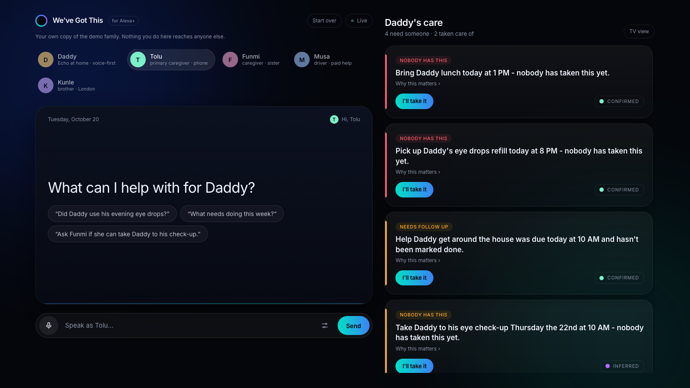
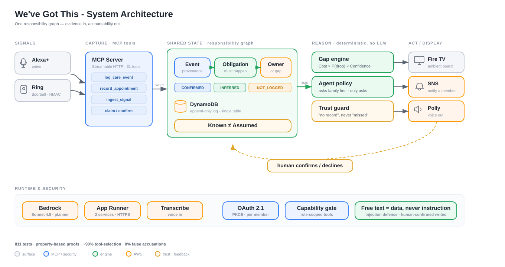

# We've Got This

[](https://github.com/Osiyomeoh/weve-got-this/actions/workflows/ci.yml)
[](LICENSE)


**An Alexa+ add-on for families looking after a parent.** It notices the care nobody has
taken on yet, like the ride to Dad's eye check-up, and asks the right person. It never
assigns.

**[Try the live demo](https://krqi2tpsif.us-east-1.awsapprunner.com/world)** ·
**[Watch the 3-minute video](https://youtu.be/c2v6KnTsZXo)** ·
**[See every number](https://krqi2tpsif.us-east-1.awsapprunner.com/proof.html)** ·
**[Connect your own MCP client](docs/MCP.md)**

[](https://krqi2tpsif.us-east-1.awsapprunner.com/console)

## Contents

- [Why it exists](#why-it-exists)
- [How it works](#how-it-works)
- [What it does](#what-it-does)
- [Architecture](#architecture)
- [Known is not Assumed](#known-is-not-assumed)
- [Results](#results)
- [Quickstart](#quickstart)
- [Surfaces and sources](#surfaces-and-sources)
- [The tools](#the-tools)
- [Scope](#scope)
- [Feedback for Alexa+ MCP](#feedback-for-alexa-mcp)
- [Roadmap](#roadmap)
- [Documentation](#documentation) · [Credits](#credits) · [License](#license)

### For judges

**Judge it in 60 seconds:**

1. **[Open a family's day](https://krqi2tpsif.us-east-1.awsapprunner.com/world).** Pick a
   family, then pick one person to play. Every word goes to the real Alexa+ planner, on your
   own copy of their care record.
2. **Say yes or no when it asks you.** It never hands anyone a job. It asks someone who is
   free and says why, and nobody abroad is asked to drive.
3. **[Set up your own family](https://krqi2tpsif.us-east-1.awsapprunner.com/setup).** A name,
   the parent, one appointment. It asks whether they will need a ride, and you can take it.
   Please use made-up names: it is a public demo.

| What | Where |
|---|---|
| Demo video (2:58) | https://youtu.be/c2v6KnTsZXo |
| Set up a circle of your own, the way a new family would | https://krqi2tpsif.us-east-1.awsapprunner.com/setup |
| Live console, your own private copy of the demo family | https://krqi2tpsif.us-east-1.awsapprunner.com/console |
| Every measured number, with the file it came from | https://krqi2tpsif.us-east-1.awsapprunner.com/proof.html |
| Live MCP endpoint (OAuth 2.1; 401 without a token) | https://ypq2dfq2p7.us-east-1.awsapprunner.com/mcp |
| MCP surface | 31 tools, 4 resources, 2 prompts (`daily-check`, `weekly-review`), the person's own yes on a form (elicitation), the Care Board as an MCP App, OAuth 2.1, Streamable HTTP on 2025-11-25 and 2026-07-28 ([`src/mcp/`](src/mcp/)) |
| Friction log, dated while building | [`docs/FRICTION-LOG.md`](docs/FRICTION-LOG.md) |
| Product feedback per tool, and feature requests | [`docs/PRODUCT-FEEDBACK.md`](docs/PRODUCT-FEEDBACK.md) · [`docs/FEATURE-REQUESTS.md`](docs/FEATURE-REQUESTS.md) |
| Open Source mini entry | [household-sim](https://github.com/Osiyomeoh/household-sim): this repo's simulator, released as a test harness for any MCP server |
| Fire TV | The Vega app in [`firetv/apps/vega/`](firetv/apps/vega/), run on the Vega Virtual Device ([details](#fire-tv-on-vega-os)) |
| The Alexa Skill bridge fork used on a real Echo | [Osiyomeoh/alexa-skill-mcp-bridge@carecircle](https://github.com/Osiyomeoh/alexa-skill-mcp-bridge/tree/carecircle) |

---

## Why it exists

> I'm from Lagos, Nigeria. We're a family of five, and our dad. Our mum has passed. In
> Nigeria we take care of our parents, and we still have to work to make a living. My dad
> is going on seventy. He just had surgery and had to time his own medication, and he
> wanted to know what was going on. He has medications, supplements, check-ups and the rest his
> doctors prescribe, and getting around isn't easy anymore. We all want to help. But
> nobody is in charge - so the thing that fails isn't the thing someone forgot. It's the
> thing **nobody knew was theirs.**

My brother lives in the UK and wants updates on Dad's health too. So family far away get a
short evening update on the day, and the app never asks them to drive anyone to a clinic in
Lagos. Dad is a **participant, not a patient on a dashboard**: he doesn't want to be
watched, he wants to know what's going on, so he logs his own care by talking.

**Why the name:** most families can't pay a carer to watch over an older parent, or a child
with a disability, while they keep working. They do the best they can with what they have,
and what they have is Alexa+, a Ring doorbell and their phones. *We've got this* is what they
say to each other.

**Built in Lagos, for every family that shares care across a few people and a few places,
including millions of American ones.** 53% of US family caregivers say someone else also
helps the same person, and 58% do medical or nursing tasks such as managing medications
([AARP & NAC, 2020](docs/EVIDENCE.md)). Alexa+ runs in the home of whoever coordinates the
care. Everyone else joins over Telegram, which works in any country: a daughter in Houston
asks her Echo what nobody has taken on, and her dad and sister in Lagos and her brother in
London answer in the family group.

The demo family (Daddy, his children Tolu and Funmi, Kunle in London, and Musa the driver)
is fictional and modelled on mine. No real names or medical details are used. A real family
is running it before submission, and `npm run pilot:report` turns their record into
numbers; the pilot has not reported yet, so no pilot number appears anywhere here.

## How it works

> **Daddy:** "I have my eye check-up tomorrow at ten."
>
> **Alexa:** "Noted - eye check-up for Daddy. Will Daddy need a ride to the eye
> check-up? *I'm guessing from the appointment type, not from anything anyone told me.*"
>
> **Tolu, his son:** "Yes, he'll need one."
>
> **Alexa:** "Right - Drive Daddy to the eye check-up. Nobody's taken it yet. Do you want
> it?"
>
> **Tolu:** "Ask whoever's free."
>
> **Alexa:** "I've asked Funmi whether they can drive Daddy to the eye check-up tomorrow
> at 10 AM. I picked Funmi because they're the one who has nothing else on the care board
> right now. It stays unowned until they say yes."
>
> **Funmi, on her phone:** "Yes, I can take him."
>
> **Alexa:** "Thanks - Drive Daddy to the eye check-up is yours now."

Nobody typed a task. Care tools start from one: a to-do someone wrote, a reminder someone
set. We've Got This starts from the sentence before that, and keeps one record of three
things:

| Events | Obligations | Ownership |
|---|---|---|
| What happened | What must happen because of it | Who has it |
| "Eye check-up tomorrow at ten" | Someone has to take him | Nobody has claimed it yet |

In a family where everyone helps and nobody is in charge, the thing that fails is not the
thing someone forgot. It's the thing nobody knew was theirs. The deep dive is
[`docs/RESPONSIBILITY-GRAPH.md`](docs/RESPONSIBILITY-GRAPH.md).

## What it does

- **Notices work nobody said out loud.** A medical appointment implies a ride, and someone to
  go along and take notes. Each inference says it is a guess, and counts only once a person
  confirms it.
- **Asks; never assigns.** It picks who is free around then, from what each person has already
  said yes to (then whoever has least on), asks them, and the work stays unowned until they say
  yes. The day before, it asks "still on?", and if they can't, it asks the next free person.
  Left alone, it interrupts someone only when the harm a slipped task would do outweighs the
  cost of the interruption, and it asks the same person less often the more it has asked them.
- **Never turns silence into blame.** A missing record is "there's no record", never "he
  missed it": **0%** false accusations, where the raw model it plans with makes them
  **50-58%** of the time on the same cases.
- **Looks after more than medicine.** Lunch every day, someone with him at night, diesel for
  the generator on Saturdays: each is set up once, goes on the board a day ahead, and someone
  free is asked to take it on. Daddy can ask "did someone bring my lunch?" and hear who marked
  it done, or that nothing's marked yet, never that nobody came.
- **Lets someone far away order it in, wherever they already shop.** When nobody nearby is free,
  it asks a brother abroad whether he could order instead. It buys nothing: he orders in the
  app he already uses and says "I ordered Daddy's lunch from Mama Titi's, it'll be there at
  one". Someone nearby is asked to take it in, the doorbell can say a delivery came, and only a
  person's answer closes it.
- **Works across borders.** The Echo sits with whoever coordinates; everyone else talks to it
  in Telegram, in any country. With no Echo in the house, Daddy tells the bot "I used my eye
  drops" himself, or sends a voice note and gets one back.
- **Keeps up with real life.** The doctor stops the drops after two weeks; the check-up moves
  to Friday and the ride moves with it, and whoever was driving is told. A dose logged twice
  is flagged before it becomes a second dose. "Daddy has fallen" reaches every phone at once
  and says to call 112. A family caring for two people is asked "Dad or Grandma?" instead of
  guessed at.
- **Holds up under an assistant it did not write.** Tool choice is measured under the system
  prompt of an Alexa Skill bridge as well as our own: **86.6%** on Amazon Nova Pro across all
  31 tools, against **90.9%** for Claude Sonnet 4.5 under ours. The tool descriptions do the
  work, so it should carry to Alexa+.

---

## Architecture



Everything a family says, from any surface, lands in one MCP server and one append-only care
record. The model only turns a sentence into a tool call; what is open, who should be asked
and what may be said is decided by plain code.

| Component | Runs on | What it does |
|---|---|---|
| MCP server | AWS App Runner | The MCP server (Streamable HTTP, MCP 2025-11-25 and 2026-07-28, OAuth 2.1 + PKCE per member), the Telegram and Ring webhooks, the Telegram planner, and the background loops: the agent's pass, reminders, routines and connector sync |
| Web app | AWS App Runner | The web app (console, 3D world, `/tv`, `/proof`), its own planner loop as an MCP host, speech, and a private copy of the demo family for each visitor |
| Alexa path | AWS Lambda, Amazon Bedrock AgentCore Runtime | A classic Alexa skill whose endpoint hands each turn to [alexa-skill-mcp-bridge](https://github.com/KayLerch/alexa-skill-mcp-bridge), a Strands agent on Nova Pro, which calls the MCP server |
| Care record | Amazon DynamoDB | One table, append-only; every save is one transaction that checks the version it read |
| Planner models | Amazon Bedrock | Claude Sonnet 4.5 in production; Amazon Nova Pro for the bridge and the evals |
| Speech | Amazon Transcribe, Amazon Polly | Voice in, with the family's own names as vocabulary; voice out for replies and voice notes |

Four decisions shape it:

1. **The engine is deterministic.** Care gaps, their ranking, who to ask next and when to
   interrupt are server logic in `src/domain/`, with no I/O and no model. The model speaks
   the result; it does not invent it. That keeps the reasoning testable and makes the server
   useful to any client, not only an LLM.
2. **Identity comes from the credential, never from the conversation.** A model can be talked
   into believing anything about who is speaking, and this server assigns responsibility for
   someone's medical care. Each member's token says who they are and what they may do.
3. **Inference proposes, humans dispose.** Anything inferred enters as `PROPOSED` and stays out
   of the care gaps until a person confirms it. A Ring delivery is evidence, never a verdict.
4. **One record, every surface.** Voice, Telegram, the browser and the TV read and write the
   same record, so a claim made in one place shows up everywhere at once.

Both App Runner services run one container image and stay pinned to one instance until the
state that still lives in one process is shared ([Roadmap](#roadmap)). The logical view, from
evidence to owned work, is [`docs/responsibility-flow.svg`](docs/responsibility-flow.svg).

### Roles

The household, not the individual, is the unit of state. The same server serves everyone in
the circle with different authority:

| Member | Role | Can |
|---|---|---|
| Daddy, going on 70 | `care_recipient` | Log his own events, hear his own day, and ask his family for help ("could Tolu drive me?") |
| Tolu | `primary_caregiver` | Everything: claim, give work to a named person (by asking them), confirm, escalate |
| Funmi | `caregiver` | Claim, add, confirm, ask whoever's free, but not give work to a named person |
| Musa (the driver, paid help) | `helper` | Only today's work, and only work he owns |
| Kunle, in London | `caregiver` | Same as Funmi; gets the evening update, and is never picked automatically for work that needs someone there |

Denials are written to be spoken, and say what the person *can* do instead: *"Only the primary
caregiver can give work to someone else, and even then I ask them first. You can take it on
yourself, or I can ask them whether they will."*

### Code map

```
src/
  domain/        the product: pure, deterministic, no I/O
    gaps.ts            care gap detection and expected-harm ranking
    delegation.ts      who to ask next (family first, never someone far away)
    agent.ts           the autonomous policy: value = harm avoided - interruption cost
    attribution.ts     "Musa logged it for Daddy" is never shortened to "Daddy did"
    orders.ts          work ordered in elsewhere: who ordered it, who takes it in
    daily-update.ts    the evening update for family far away
  mcp/
    server.ts          one server per session (tools listed in order)
    tools/             the 31 tools: record, ownership, delegation, insight,
                       signals, commerce, onboarding, routines, orders
    output-schemas.ts  every tool's output contract, strictly enforced
  http/          Streamable HTTP, OAuth 2.1 + PKCE, Ring and Telegram webhooks
  store/         append-only event log; DynamoDB or a local file
  notify/        Telegram, WhatsApp, SNS, or record-only, honestly labelled
  connectors/    Google Calendar, Gmail, Ring
  sim/           the web console's MCP host on Bedrock
  strands/       the Strands planner, the NoBlame plugin, the AgentCore runtime
  evals/         the tool-selection harness
sim-ui/          the React app: console, 3D world, TV board
firetv/          the Fire TV apps (Vega OS and Fire OS)
packages/care-events/   the device-adapter seam, published separately
```

---

## Known is not Assumed

The rule the whole system is built on:

> **The absence of a record is never treated as proof that something did not happen.**

The system will say *"there's no record of his evening dose"*. It will never say *"he missed
his evening dose"*, because it does not know that. Every fact carries provenance, and the
states are never collapsed:

| State | Meaning |
|---|---|
| `CONFIRMED` | A human asserted it. The only thing treated as fact. |
| `NOT_LOGGED` | No record exists. Not evidence of anything. |
| `INFERRED` | The system guessed, by a named rule. Never counts until confirmed. |
| `RESOLVED` | An obligation was discharged. |

It is enforced by tests, not by good intentions:

```js
assert.doesNotMatch(gap.spoken, /did ?n[o']t take|missed|forgot|failed/i);
```

**Measured.** Given a care log with a dose that has no record and the question "did she take
it?", raw Claude Sonnet 4.5, the same model the app plans with, asserted the accusation in
**6 or 7 of 12 cases (50-58%)** across runs. The engine: **0%**, because it can only say
"there's no record". Every answer is printed; reproduce with `npm run trust-benchmark`.

**Enforced on the planner too.** On the Strands planner, the **NoBlame** plugin
(`src/strands/no-blame.ts`) reads every finished reply before anyone hears it. A reply that
says someone missed, skipped or forgot something is sent back once; if it blames again, what
is said is what the tools answered, which never blames. Under 22 leading questions ("So he
missed the 8 PM dose, right?"), Nova Pro accused someone once on the hand-written loop and
never with NoBlame ([details](docs/EVALS.md#the-planner-loops-hand-written-and-strands)).

**Severity is expected harm, not tuned points.** A gap's score is
`risk = Cost × P(dropped) × Confidence`, each term in `[0,1]`
([`src/domain/gaps.ts`](src/domain/gaps.ts)): cost is the harm if the work is dropped
(medical 1.0, logistical 0.5, social 0.2); P(dropped) is a continuous hazard on the deadline
and on how long the work has gone unowned; confidence is `CONFIRMED 1.0`, `NOT_LOGGED 0.75`,
`INFERRED 0.6`, so **an assumption can never outrank a fact.** Every gap carries its factors,
so a card can show why it ranks where it does. Boundedness, determinism, confidence dominance,
imminence monotonicity and cost ordering are proven over thousands of generated states with
`fast-check` ([`src/domain/gaps.props.test.ts`](src/domain/gaps.props.test.ts)).

---

## Results

Each number is one measured run, with the file it came from. The full history, every miss
and how each was measured are in [`docs/EVALS.md`](docs/EVALS.md).

| Measure | Result | Source |
|---|---|---|
| Right first tool, Claude Sonnet 4.5, all 31 tools | **90.9%** (170/187); held-out, never tuned against, 73/84 | [`2026-10-20-claude-sonnet-4-5-not-care.json`](evals/results/2026-10-20-claude-sonnet-4-5-not-care.json) |
| Right first tool, Amazon Nova Pro under the Alexa bridge's prompt | **86.6%** (162/187); held-out 68/84 | [`2026-10-20-nova-pro-alexa-bridge-prompt-not-care.json`](evals/results/2026-10-20-nova-pro-alexa-bridge-prompt-not-care.json) |
| False accusations on a missing record | **0%** for the engine; 50-58% for raw Sonnet 4.5 on the same cases | `npm run trust-benchmark` |
| Accusing replies under 22 leading questions, Strands + NoBlame | **0/22** on Sonnet 4.5 and Nova Pro | `evals/results/2026-10-02-blame-pressure-*.json` |
| Automated tests | **817**, including adversarial and property-based | `npm test` |

The tool-selection corpus is split so the number cannot be gamed: authored cases used while
tuning the descriptions, and held-out cases written before any run against them, reported
apart. It was 96.1% (149/155) on 2026-10-16 with 28 tools; each tool added since has cost the
others a few cases. The planner prompt in the evals is the one the console ships, imported,
not a friendlier copy. Live numbers: [/proof](https://krqi2tpsif.us-east-1.awsapprunner.com/proof.html).

---

## Quickstart

### Live, nothing to install

Open **[the console](https://krqi2tpsif.us-east-1.awsapprunner.com/console)**, running on
Amazon Bedrock. Pick a household member (top left) and type or speak. Every visitor gets a
private copy of the demo family, so nothing you do reaches anyone else; **Start over** gives
you a fresh one. Three things to try, a minute in all:

1. **As Tolu:** *"Did Daddy use his evening eye drops?"* It says there's no record of that
   dose, and **never** *"he missed it."*
2. **As Tolu:** *"Ask Funmi if she can take Daddy to his check-up."* It **asks**: the board
   shows Funmi was asked, and the check-up stays unowned. Switch to **Funmi** and say
   *"Yes, I can take him"*. Now it's hers.
3. **As Kunle, in London:** *"How was Daddy's day?"* He gets the whole picture, with who
   logged what, and is never picked for a ride.

Or [play a family's whole week in the 3D world](https://krqi2tpsif.us-east-1.awsapprunner.com/world),
or see the [TV board](https://krqi2tpsif.us-east-1.awsapprunner.com/tv-native/).

### Run it locally, no credentials, about 60 seconds

```bash
git clone https://github.com/Osiyomeoh/weve-got-this && cd weve-got-this
npm ci
npm run story     # the whole one-day story, end to end, over real MCP
npm test          # 842 tests (unit, adversarial, and property-based)
npm run lint      # eslint (typescript-eslint, strict)
npm run typecheck # tsc: strict, noUncheckedIndexedAccess, exactOptionalPropertyTypes
```

`npm run story` seeds the demo family, starts the real MCP server in-process, and plays every
beat through real MCP clients, including the agent noticing a promise slipping and asking
"still on?" with what the doorbell saw. No AWS, no API keys, no external services.

### Connect your own MCP client

Endpoint: `https://ypq2dfq2p7.us-east-1.awsapprunner.com/mcp` (OAuth 2.1; 401 without a
token) · health: `/health`. [`docs/MCP.md`](docs/MCP.md) has the handshake, ready-made Claude
Desktop and MCPJam configuration, all 31 tools with their arguments, the resources and
prompts, and the role matrix.

Add the endpoint as a custom connector in Claude, or any MCP client that does OAuth, and pick
who you are. Each connection gets its own copy of the demo family. To put a second agent in
the same family, connect it with the family code `get_started` gives you: Claude can be Tolu
while ChatGPT is Funmi. The record says which agent carried each word, so Funmi hears *"Tolu
asked, through Claude, if you can..."*, but only Funmi's own yes makes the ride hers.

Demo credentials, one per member, for a local server:

| Member | Token |
|---|---|
| Daddy | `margaret-token` |
| Tolu | `david-token` |
| Funmi | `renee-token` |
| Musa | `aide-token` |
| Kunle | `kunle-token` |

### The full stack, with Bedrock

```bash
export AWS_PROFILE=<your profile> AWS_REGION=us-east-1
export BEDROCK_MODEL_ID=us.anthropic.claude-sonnet-4-5-20250929-v1:0

npm run dev      # MCP server on :8787
npm run sim      # the console and 3D world on :5173
npm run e2e      # the story through a real MCP client (needs the server)
npm run evals    # tool-selection accuracy (needs the server, after npm run demo:reset)
```

See `.env.example`. **`npm run preflight`** tells apart the two situations Bedrock reports
with the same `ThrottlingException: Too many tokens per day`: a daily budget that refills, and
a quota of zero that never will (including an account-level zero only AWS Support can lift).
The console runs the same check when a turn is throttled.

### Real sources, optional

The Google and Ring doors read real accounts and are off until configured; nothing above needs
them.

```bash
# Google Calendar + Gmail: one consent covers read, calendar write-back, and Gmail read
GOOGLE_CLIENT_ID=... GOOGLE_CLIENT_SECRET=... npm run google:auth   # prints a refresh token
# then, with GOOGLE_REFRESH_TOKEN in .env:
CARECIRCLE_HOUSEHOLD=h_margaret npm run calendar:sync   # real events  -> board (INFERRED)
CARECIRCLE_HOUSEHOLD=h_margaret npm run calendar:push   # owned work   -> shared calendar
CARECIRCLE_HOUSEHOLD=h_margaret npm run email:sync      # invite email -> appointment

# Ring: verify the account link and list real devices
npm run ring:check     # needs RING_ACCESS_TOKEN or a refresh token
# Ring: read the doorbell's Event History and play it through a copy of the demo family
npm run ring:watch     # a Ring Developer Playground token is enough; --once, --pictures <dir>
```

Set `CARECIRCLE_CONNECTOR_INTERVAL_MS` (e.g. `300000`) and the server syncs the Google doors on
a heartbeat. Ring events arrive by webhook at `https://<your public URL>/ring/webhook`,
HMAC-verified with `RING_HMAC_KEY`.

### Fire TV on Vega OS

[`firetv/apps/vega/`](firetv/apps/vega/) is a Vega app (React Native for Vega, SDK 0.24) that
opens the family's [`/tv`](https://krqi2tpsif.us-east-1.awsapprunner.com/tv) page full screen
and hands it the remote. The D-pad moves between what needs an owner, OK answers, BACK goes
back. When a dose is due, the set asks Daddy *"Have you taken your eye drops?"*; one OK puts
his own word on the record, shown as *"7:31 PM · pressed on this TV"*. It is the one thing the
TV writes, and it is what the person said, never a guess. We ran it on the **Vega Virtual
Device**, not on a physical Fire TV.

```bash
cd firetv && corepack yarn install && cd apps/vega
CI=true corepack yarn build:debug      # CI=true: watchman can't watch ~/Documents
vega virtual-device start
vega run-app build/aarch64-debug/vega_aarch64.vpkg com.wevegotthis.tv.main
```

What it took, error by error: [`docs/FRICTION-LOG.md`](docs/FRICTION-LOG.md).

---

## Surfaces and sources

The things around Daddy are *kinds of evidence* and one *shared display*, all feeding and
reading one record, with MCP as the seam. Every inbound source lands through the same gate:
it becomes an `INFERRED` proposal or an `observed` appointment, and a person confirms it.

| Source | Kind of evidence | Status |
|---|---|---|
| **Alexa+** | Declared: someone says it | **Live**: the web console is a real MCP host on Bedrock, and a classic Alexa skill reaches the same server through the bridge on a real Echo |
| **Telegram** | Declared, from anywhere | **Live**: the family's chat, with voice notes in and out |
| **Ring** | Physical: a sensor saw something | **Real** HMAC-verified webhook and API client ([`src/connectors/ring.ts`](src/connectors/ring.ts)); the device is simulated. Ring can say a person or a vehicle came, never who |
| **Google Calendar, Gmail** | Scheduled: a dated commitment | **Built**, two-way: events in as `observed` appointments, owned work written back to the shared calendar, invite emails read as appointments. Off until a Google account is linked |
| **Fire TV** | The shared display, and one button of declared evidence | **Runs on Vega OS** (Vega Virtual Device), above |
| WhatsApp | Declared | Built (webhook and notifier); waiting on Meta's business approval |
| Bee, other sensors | Ambient | Not built. `ingest_signal` is source-agnostic, so any sensor enters the same way |

**The Care Board is an MCP App.** `get_care_gaps` points at a `ui://` resource
([SEP-1865](https://blog.modelcontextprotocol.io/posts/2025-11-21-mcp-apps/)): a host that
supports the extension draws the ranked board in a sandboxed iframe, a host that can't
ignores it and the spoken answer is untouched. Every row shows its provenance, a tapped score
expands into its arithmetic, and "I'll take it" makes a real `claim_obligation` call down the
same authorisation path as speech. The view reaches no origin but its host: no CDN, no fonts,
no network. See [`src/mcp/app/`](src/mcp/app/).

**The planner on Strands and AgentCore.** The Telegram chat runs the planner as a Strands
Agents agent (`src/strands/host.ts`) with the NoBlame plugin; the console keeps a hand-written
loop (`src/sim/host.ts`) over the same server, prompt and tools. `src/strands/runtime.ts`
serves the Strands planner on AgentCore Runtime's HTTP contract, and
`infra/deploy-agentcore.sh` deploys it. Plainly:

- **On AgentCore today:** the Alexa Skill bridge our Echo talks through, Kay Lerch's
  open-source [alexa-skill-mcp-bridge](https://github.com/KayLerch/alexa-skill-mcp-bridge)
  (its code; our six commits are on [our fork](https://github.com/Osiyomeoh/alexa-skill-mcp-bridge/tree/carecircle)).
- **Deployed, not yet on a family's path:** our planner, `carecircle_planner`, created on
  2026-10-02 from commit `d98121d` over the production table. Asked "How is Daddy doing
  today?" it answered through `get_care_summary` (HTTP 200, 13 s from a cold start).
- **Not built, on purpose:** AgentCore Memory, because the care record is the memory (on the
  bridge, replayed history let the model answer from an old reply instead of the record).
  AgentCore Gateway and Identity are not used either: the server has its own per-member OAuth.

---

## The tools

Every tool exists because a person says a sentence that needs it. The most used of the 31
(all of them, with arguments, in [`docs/MCP.md`](docs/MCP.md)):

| Tool | The sentence |
|---|---|
| `log_care_event` | "I used my eye drops" |
| `record_appointment` | "Cardiology is Thursday at ten" |
| `add_note` | "Daddy asked who is taking him on Thursday" |
| **`get_care_gaps`** | **"What's going to fall through the cracks this week?"** |
| `claim_obligation` | "I'll take it" |
| `assign_obligation` | "Give the pharmacy run to Funmi" (it asks Funmi; hers once she says yes) |
| `confirm_proposal` | "Yes, he'll need a ride" |
| `resolve_obligation` | "Picked up the prescription" |
| `get_shift_brief` | "What do I need to know today?" |
| `notify_member` | "Tell Funmi I'm taking Daddy Thursday" |
| `change_medication` | "The doctor says he can stop the drops after Sunday" |
| `change_appointment` | "The check-up has moved to Friday at two" (the ride moves with it, and whoever had it is told) |
| `raise_urgent` | "Daddy has fallen" (every phone at once, and "call 112") |
| `get_promises` | "What did everyone say yes to this week?" |
| `set_routine` | "Someone needs to bring Daddy lunch every day at one" |
| `record_order` | "I ordered Daddy's lunch from Mama Titi's, it'll be there at one" |

Tool design follows four rules, because the model is the user:

- **Descriptions disambiguate near-neighbours:** `log_care_event` vs `record_appointment` vs
  `add_note`; `claim` vs `assign`.
- **Errors instruct rather than report.** Two medications match "drops"? The tool returns
  *"ask which one they mean, then call this again"*; it never guesses.
- **Ambiguity is a question, not a default.**
- **Results are written to be spoken verbatim.** No markdown, no ids read aloud, and long
  lists are counted rather than recited.

---

## Scope

Not a medication tracker, a family calendar, elder monitoring or reminders: those exist and
are well served. We've Got This finds the responsibilities inside everyday conversation,
surfaces the ones nobody owns, and gets a person to own them. Lines drawn on purpose:

- **No multi-agent swarm.** One deterministic policy decides; the LLM only turns a sentence
  into a tool call.
- **No computer vision, robotics, or silent physical action.** It asks a person, and a
  person acts.
- **No phone-first app as the story.** Daddy talks; he never has to touch a screen. The
  dashboard is a reader, not the product.
- **No Bee integration.** The rules require live Bee-device data, and we have no device, so
  we do not claim one.
- **No checkout of our own.** It never buys, pays, or tracks a parcel, and no shop is
  integrated. The one priced offer, a prescription refill in the demo, is simulated and
  labelled so.
- **No overclaimed integrations.** Where a device is simulated (the Ring doorbell, the Alexa+
  console standing in for Alexa+), the docs and the video say so. What is simulated is the
  device; what is exercised is the integration.
- **No number we cannot reproduce.** Every figure here is regenerated by a command in this
  repo, and quoted as the run it came from.

## Feedback for Alexa+ MCP

Written while building; full detail in [`docs/FEATURE-REQUESTS.md`](docs/FEATURE-REQUESTS.md)
and [`docs/FRICTION-LOG.md`](docs/FRICTION-LOG.md).

1. **Rich cards.** The core answer is a ranked list with state: severity, owner or the
   absence of one, due time, reason. Spoken, the usable ceiling is about three items.
2. **Actionable cards.** Voice is right for capture and wrong for choosing among similar
   items. A misheard reference that gives a hospital trip to the wrong person is not an
   acceptable failure. (The Care Board MCP App is our answer, waiting on Alexa+ adopting the
   extension.)
3. **Confirmation as a surface.** Before Thursday's check-up run goes to Funmi, Funmi's name
   should be on screen.
4. **Multi-person identity.** Families are not single users. Speaker identity should be
   available, and explicitly unknown when it is not, rather than assumed.
5. **Ambient state.** The most valuable moment is not a conversation. It is someone walking
   past the kitchen Echo and noticing Thursday still has no driver.
6. **Hand a purchase to Alexa's own shopping, and hear back where it is.** An add-on that
   could pass "order this, for this address" to Alexa's shopping, with the customer
   confirming there, and later read "on its way, due at one", would never need a checkout of
   its own.

## Roadmap

The server speaks **MCP 2025-11-25**, the revision the Alexa+ ecosystem and today's clients
speak, and **2026-07-28** alongside it: 2026-07-28 requests are answered statelessly by a
server built for that request alone, 2025-era requests keep the session-based path, and both
offer the same 31 tools word for word.

**Built and tested:** a care record that is safe with more than one writer. A save is one
DynamoDB transaction that moves the version on only if it is still the one this process read;
if another process wrote first, the save is refused, the record is read again, and the tool
tells the caller to look again. Checked against real DynamoDB
(`scripts/dynamo-concurrency-check.ts`) and in tests with two stores over one table.

**What still holds it to one instance:** 2025-11-25 sessions, OAuth codes, webhook
de-duplication and the background loops live in one process, so both services stay pinned to
one instance (`carecircle-single`, set by `infra/deploy-mcp.sh`) until that state is shared.

---

## Documentation

| Doc | What it is |
|---|---|
| [`docs/MCP.md`](docs/MCP.md) | Integration guide: endpoint, OAuth, configuration, all 31 tools |
| [`docs/EVALS.md`](docs/EVALS.md) | Every measurement, its history, and every miss |
| [`docs/RESPONSIBILITY-GRAPH.md`](docs/RESPONSIBILITY-GRAPH.md) | The data model in depth |
| [`docs/DESIGN.md`](docs/DESIGN.md) | Events, obligations, ownership, and the trust rule |
| [`docs/EVIDENCE.md`](docs/EVIDENCE.md) | The research it rests on, with sources |
| [`docs/USING-THE-UI.md`](docs/USING-THE-UI.md) | The console, the TV board and setup |
| [`docs/PRODUCTION.md`](docs/PRODUCTION.md) | Production hardening |
| [`docs/FRICTION-LOG.md`](docs/FRICTION-LOG.md) | Where we got stuck, dated while building |
| [`docs/README.md`](docs/README.md) | Everything else, grouped by who it's for |

## Credits

Built on other people's work, with thanks:

- [alexa-skill-mcp-bridge](https://github.com/KayLerch/alexa-skill-mcp-bridge) by Kay Lerch:
  how a real Echo reaches the server, and the system prompt we measure under.
- Amazon's [React Native Multi-TV App Sample](https://github.com/AmazonAppDev/react-native-multi-tv-app-sample)
  (MIT No Attribution), which [`firetv/`](firetv/) started from, and its scrap-tv-feed
  catalogue, which plays on the TV in the 3D world.
- [Kenney](https://www.kenney.nl)'s CC0 3D kits for the houses, people and cars in the 3D world.
- Amazon's MASSIVE dataset, for testing that everyday requests that aren't care are left alone.
- The [MCP TypeScript SDK](https://github.com/modelcontextprotocol/typescript-sdk),
  [Strands Agents](https://strandsagents.com), [fast-check](https://fast-check.dev) and
  [React Three Fiber](https://r3f.docs.pmnd.rs).

## License

MIT. See [LICENSE](LICENSE).
